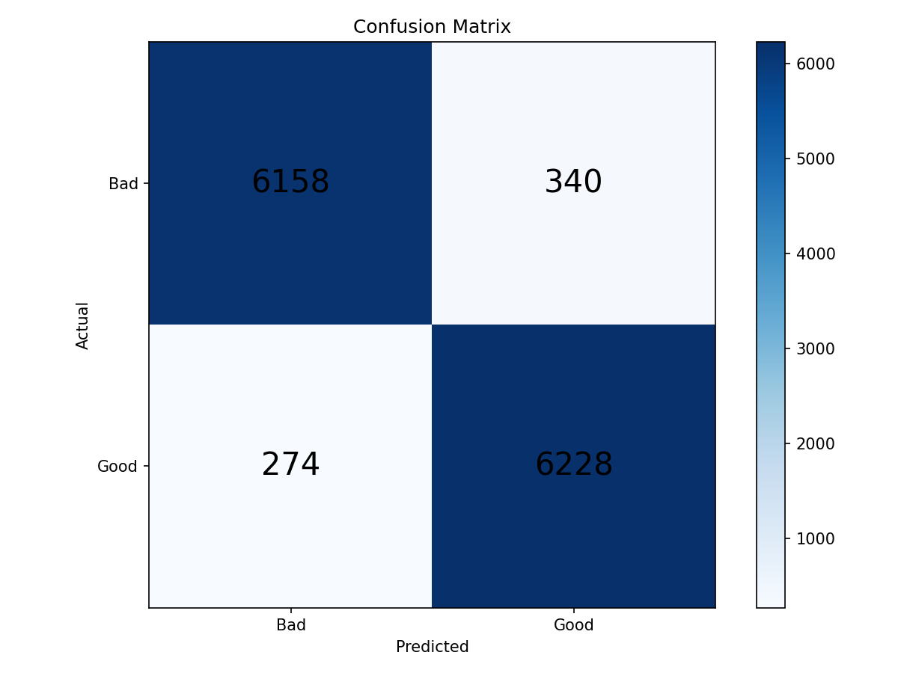

# Smart Posture Corrector (TinyML on ESP32-S3)

Носимое устройство для мониторинга и коррекции осанки в реальном времени с использованием TinyML (TensorFlow Lite for Microcontrollers) на микроконтроллере ESP32-S3 и акселерометре MPU-6050.

## Структура проекта

```text
smart-posture-corrector/
├── assets/                          # Графики обучения и схемы работы
│   ├── confusion_matrix_binary.png
│   ├── training_binary_history.png
│   ├── flowchart_inference.png
│   ├── flowchart_loop.png
│   └── flowchart_setup.png
├── firmware/
│   ├── smart_posture_corrector.ino  # Главный координатор системы
│   ├── config.h                     # Конфигурация пинов, порогов и гиперпараметров
│   ├── imu.h / imu.cpp              # Драйвер MPU-6050 и EMA-фильтрация
│   ├── classifier.h / classifier.cpp # Инференс TinyML (TFLite Micro)
│   ├── feedback.h / feedback.cpp    # Неблокирующий контроллер виброотклика
│   ├── posture_model.h              # Скомпилированные веса модели (C-массив)
│   └── calibration/                 # Утилиты калибровки сенсора
├── training/
│   ├── generate_dataset.py          # Генерация датасета акселерометра
│   ├── train_model.py               # Обучение модели и экспорт в TFLite / C-header
│   ├── normalization_params.txt     # Параметры нормализации (mean, std)
│   └── posture_model.tflite         # Квантованная модель TFLite
├── platformio.ini                   # Конфигурация для сборки в PlatformIO
├── .gitignore
└── README.md
```

## Аппаратная часть

- Микроконтроллер: ESP32-S3-ZERO
- IMU: MPU-6050 (I2C)
- Виброотклик: вибромотор 3V, управляемый через N-канальный MOSFET 2N7002 (GPIO 4)
- Питание: Li-Po аккумулятор 3.7V с контроллером заряда TP4056

### Подключение

- `MPU-6050 SDA` -> `GPIO 8`
- `MPU-6050 SCL` -> `GPIO 9`
- `Вибромотор (MOSFET Gate)` -> `GPIO 4`

## Обучение модели

1. Генерация данных:
   ```bash
   python training/generate_dataset.py
   ```
2. Обучение классификатора и экспорт в `posture_model.h`:
   ```bash
   python training/train_model.py
   ```



## Прошивка

### Через Arduino IDE
1. Установите поддержку плат ESP32 (версия 2.0.x / 3.0.x).
2. Установите библиотеку `Chirale_TensorFlowLite` (или `TensorFlowLite_ESP32`).
3. Откройте [firmware/smart_posture_corrector.ino](firmware/smart_posture_corrector.ino).
4. Выберите плату `ESP32S3 Dev Module`.
5. Загрузите прошивку и откройте Serial Monitor на скорости `115200`.

### Через PlatformIO
```bash
pio run --target upload
pio device monitor
```
