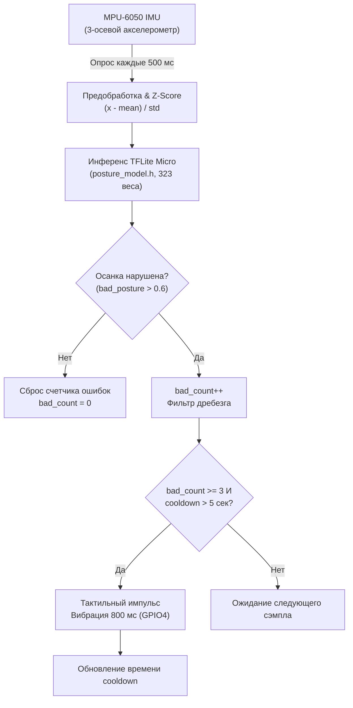

# Smart Posture Corrector (TinyML on ESP32-S3)

[](https://www.espressif.com/)
[](https://isocpp.org/)
[](https://arduino.cc/)
[](https://www.tensorflow.org/lite/microcontrollers)
[](LICENSE)

Носимое IoT-устройство для мониторинга и коррекции осанки в реальном времени с использованием **TinyML (TensorFlow Lite for Microcontrollers)** на базе микроконтроллера **ESP32-S3-ZERO** и 6-осевого IMU сенсора **MPU-6050**. Устройство полностью автономно, не требует постоянного сопряжения со смартфоном или облачных вычислений и обеспечивает до 30+ часов работы от одного заряда.

---

## 📌 Принцип Работы и Алгоритм



### Ключевые особенности алгоритма:
- **Многократное подтверждение (Confirmation Filter):** Чтобы исключить ложные срабатывания при кратковременных движениях, наклонах или смене позы, вибросигнал подается только при **3 последовательных детекциях** нарушения (время реакции ~1.5 секунды).
- **Интеллектуальный Cooldown (5 сек):** Защита пользователя от непрерывного раздражающего виброотклика.
- **Низкое энергопотребление:** Инференс нейросети выполняется за миллисекунды, остальное время контроллер проводит в энергоэффективном ожидании.

---

## 🛠️ Спецификация Оборудования (BOM)

| Компонент | Назначение | Характеристики / Модель |
|---|---|---|
| **Микроконтроллер** | Вычисления, TinyML инференс | **ESP32-S3-ZERO** (Xtensa LX7 Dual-Core, 240 МГц) |
| **IMU Датчик** | Измерение гравитационного вектора | **MPU-6050** (акселерометр ±2g, I2C) |
| **Вибромодуль** | Тактильная обратная связь | Цилиндрический микромотор 10×25 мм, 3.0–3.7 В, ~70 мА |
| **Ключ управления** | Коммутация вибромотора | N-канальный MOSFET **2N7002** + диод **1N4148** |
| **Контроллер заряда** | Зарядка аккумулятора по USB-C | **TP4056** с платой защиты (DW01A + 8205A) |
| **Аккумулятор** | Автономное питание | Li-Po **ROBITON LP103450** 3.7V, 1800 мАч |

---

## 🔌 Схема Подключения (Pinout)

```
        +-------------------+
        |   ESP32-S3-ZERO   |
        |                   |
        |  GPIO 8  (SDA)  -----> MPU-6050 SDA
        |  GPIO 9  (SCL)  -----> MPU-6050 SCL
        |  GPIO 4  (VIBRO) ----> Затвор MOSFET (2N7002) --> Вибромотор
        |  3V3    ---------> Питание MPU-6050 & логика
        |  GND    ---------> Общая земля (GND)
        +-------------------+
                  ^
                  | 3.3V / BAT
        +-------------------+
        |      TP4056       |<---- Li-Po 1800mAh
        |   (USB-C Charge)  |
        +-------------------+
```

---

## 🧠 TinyML Модель и Ресурсы

Нейросетевая модель оптимизирована для микроконтроллеров и преобразована в C-массив байт (`posture_model.h`):

- **Архитектура:** Полносвязная сеть прямого распространения (Dense Feedforward Neural Network).
- **Количество параметров:** 323 веса.
- **Размер модели во Flash:** ~3.98 КБ.
- **Выделенная память (Tensor Arena):** 8 КБ SRAM.
- **Суммарное использование памяти:** ~20 КБ SRAM (включая стек, глобальные переменные и runtime TFLite).
- **Точность классификации (Test Accuracy):** **89.2%** (при лабораторном тестировании на добровольцах — **87%** точности удержания осанки).

---

## 🔋 Энергопотребление и Автономность

- **Среднее потребление в активном режиме:** ~45–50 мА (ESP32-S3: ~40 мА, MPU-6050: ~4 мА, периферия: ~6 мА).
- **Ёмкость аккумулятора:** 1800 мАч.
- **Расчетное время работы:** `1800 мАч / 50 мА * 0.85 (КПД) ≈ 30–36 часов` непрерывного ношения.
- **Время полной зарядки (при 500 мА):** ~4 часа.

---

## 📁 Структура Проекта

```text
smart-posture-corrector/
├── firmware/
│   ├── smart_posture_corrector.ino  # Основной скетч (Arduino / C++)
│   └── posture_model.h             # Скомпилированные веса TFLite Micro
├── docs/
│   └── posture_coursework_with_graphs.docx  # Полное техническое описание
├── platformio.ini                  # Конфигурация для сборки в PlatformIO
├── .gitignore
└── README.md
```

---

## 💻 Сборка и Прошивка

### Вариант 1: Через PlatformIO (VS Code)

1. Откройте папку проекта в VS Code с установленным расширением PlatformIO.
2. Подключите ESP32-S3 через USB.
3. Нажмите кнопку **PlatformIO: Upload** в нижней панели или выполните:
   ```bash
   pio run --target upload
   pio device monitor
   ```

### Вариант 2: Через Arduino IDE

1. Установите поддержку плат **ESP32** от Espressif в Board Manager.
2. Установите библиотеку **Chirale_TensorFlowLite** (или `TensorFlowLite_ESP32`).
3. Откройте `firmware/smart_posture_corrector.ino`.
4. Выберите плату `ESP32S3 Dev Module` (или `ESP32-S3-ZERO`).
5. Нажмите **Загрузка (Upload)**.
6. Откройте Serial Monitor на скорости **115200 бод** для просмотра телеметрии (углы, вероятности и статус).

---

## 📄 Лицензия

MIT License. Свободно для академического и коммерческого использования с указанием авторства.
