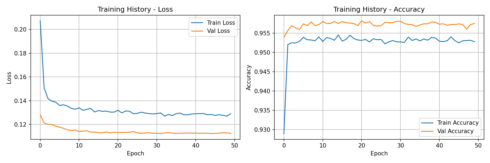

# Smart Posture Corrector (TinyML on ESP32-S3)

Носимое устройство для мониторинга и коррекции осанки в реальном времени с использованием TinyML (TensorFlow Lite for Microcontrollers) на микроконтроллере ESP32-S3 и трехосевом акселерометре MPU-6050.

## Структура проекта

```text
smart-posture-corrector/
├── assets/
│   └── training_binary_history.png  # График обучения модели (Loss / Accuracy)
├── firmware/
│   ├── smart_posture_corrector.ino  # Главный координатор системы
│   ├── config.h                     # Конфигурация пинов, порогов и гиперпараметров
│   ├── imu.h / imu.cpp              # Драйвер MPU-6050 и EMA-фильтрация
│   ├── classifier.h / classifier.cpp # Инференс TinyML (TFLite Micro)
│   ├── feedback.h / feedback.cpp    # Неблокирующий контроллер виброотклика
│   ├── posture_model.h              # Квантованные веса модели (C-массив)
│   └── calibration/                 # Утилиты калибровки сенсора
├── training/
│   ├── generate_dataset.py          # Генерация синтетического датасета акселерометра
│   ├── train_model.py               # Обучение MLP-классификатора и экспорт в TFLite
│   ├── normalization_params.txt     # Параметры стандартизации (mean, std)
│   └── posture_model.tflite         # Квантованная модель TFLite
├── platformio.ini                   # Конфигурация для сборки в PlatformIO
├── .gitignore
└── README.md
```

## Аппаратная часть

- **Микроконтроллер:** ESP32-S3 (ESP32-S3-ZERO)
- **Сенсор (IMU):** MPU-6050 (интерфейс I2C)
- **Виброотклик:** миниатюрный вибромотор 3V, управляемый через N-канальный MOSFET 2N7002
- **Питание:** Li-Po аккумулятор 3.7V с платой контроллера заряда TP4056

## Обучение модели (TinyML Pipeline)

Классификатор построен на базе полносвязной нейросети (MLP):
- Вход: 3 признака (ускорения `acc_x`, `acc_y`, `acc_z` с EMA-фильтрацией)
- Скрытые слои: Dense(16, ReLU) -> Dropout -> Dense(8, ReLU) -> Dropout
- Выход: Dense(1, Sigmoid) — вероятность правильной осанки

1. **Генерация датасета:**
   ```bash
   python training/generate_dataset.py
   ```
2. **Обучение модели и экспорт весов:**
   ```bash
   python training/train_model.py
   ```

Скрипт автоматически сохраняет параметры нормализации (`normalization_params.txt`), квантует модель в формат TFLite и генерирует заголовочный C-файл `posture_model.h` для прошивки.

### Результаты обучения


